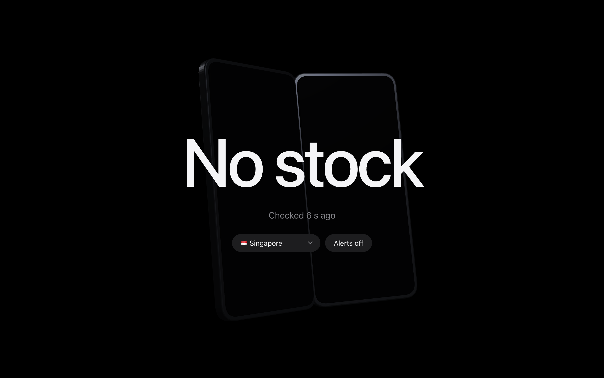
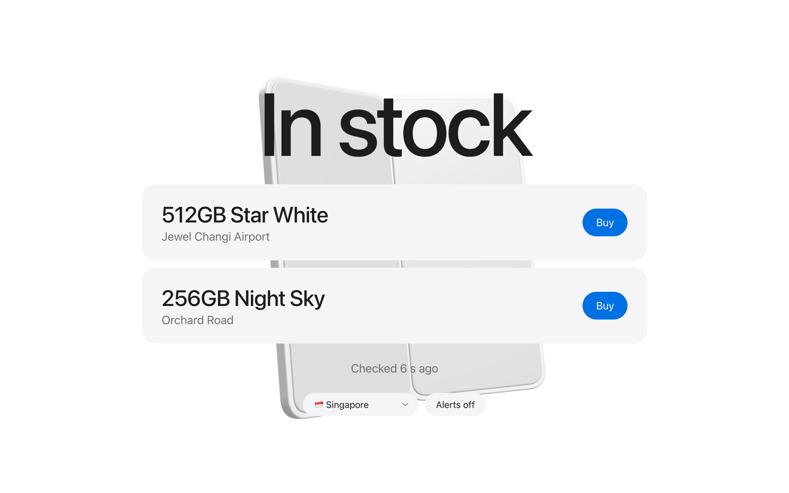
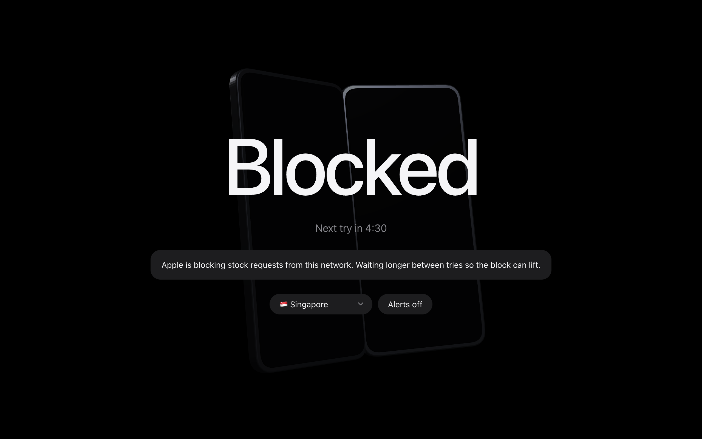

# Duo Stock Watch

One page that answers one question: which Apple Store has an iPhone Duo for pickup right now.

It runs on your own computer. A small local server asks Apple's pickup endpoint about once a minute
and the page shows the result.

- **Black screen**: no stock.
- **White screen**: in stock, with the configuration, the store, and a link to buy.

No account, no hosting, nothing to install. The folding phone in the background is drawn with
[three.js](https://threejs.org), loaded from a CDN; the page works without it.

## Screenshots

Captured from the real page with sample data.

| No stock | In stock |
| --- | --- |
|  |  |

When Apple is rate limiting your network:



## Quick start

Needs [Node.js](https://nodejs.org) 20 or newer.

```bash
git clone https://github.com/jiaweing/duo-stock-watch.git
cd duo-stock-watch
node server.mjs
```

Then open http://localhost:4173 in any browser.

Leave the terminal running. The server keeps checking even when the page is closed. Stop it with
`Ctrl+C`.

To use another port:

```bash
PORT=5000 node server.mjs
```

## Using the page

| Control | What it does |
| --- | --- |
| Country | Picks which country's Apple Stores to watch. Saved in `config.json`. |
| Postcode or city | Shown only for large countries, where Apple returns the stores nearest that place. |
| Alerts | Click once to turn on sound and browser notifications for the open page. |

The headline tells you the state:

| Headline | Meaning |
| --- | --- |
| No stock | Apple answered and nothing is available for pickup. |
| In stock | At least one configuration is available. Each one is listed with its store. |
| Blocked | Apple is refusing requests from your network. A countdown shows the next try. |
| No stores | Apple found no stores near the postcode or city you entered. |
| Check failed | The request to Apple did not go through. It retries in a minute. |
| Server stopped | The page cannot reach `server.mjs`. Start it again. |

## Alerts

- **macOS notification**: sent by the server when new stock appears, even with the page closed.
- **Browser notification and beeps**: sent by the open page after you turn Alerts on.

An alert fires once each time a configuration appears at a store. If it sells out and comes back, it
fires again.

## Supported countries

Singapore, Malaysia, Hong Kong, Taiwan, Thailand, Japan, South Korea, India, Australia, UAE, United
Kingdom, Germany, France, Canada, United States.

To add one, add a row to `COUNTRIES` in `server.mjs` with the country's apple.com path, its eight
iPhone Duo part numbers (found in the source of that country's buy page), and a default postcode.

## How it works

Browsers refuse to read `apple.com` from another site's page, so the page cannot ask Apple itself.
`server.mjs` does it instead:

```
page  ->  localhost:4173/api/state  ->  server.mjs  ->  apple.com/<country>/shop/retail/pickup-message
```

The server sends one request covering all eight configurations and reads `pickupDisplay` for each
store in the reply. However many tabs you open, Apple still gets one request per interval.

The server listens on `127.0.0.1` only and rejects requests from other sites.

The endpoint is unofficial. Apple can change or remove it at any time.

## Rate limits

Apple blocks networks that ask too often. A blocked request comes back as HTTP 541, with a
misleading "Page Not Found" body. Apple publishes no limit, so the numbers below are what other
people's checkers have reported, not guarantees:

| Reported pace | Reported result |
| --- | --- |
| About 30 requests back to back | Blocked for 10 to 15 minutes |
| About 6 requests a minute | Blocked for about 43 minutes |
| 1 request every 30 seconds | Blocked within about an hour |
| 1 request every 45 to 120 seconds | Ran for hours without a block |

So this server:

- asks once every 60 to 75 seconds, at a slightly random gap;
- never asks more than once every 20 seconds, even when you switch country;
- waits 15, then 30, then 45 minutes after a block;
- shows **Blocked** with a countdown, and never reports a blocked check as "No stock".

Other things that get you blocked:

- Running several copies, or several different checkers, on one network.
- Hosting it on a cloud server or behind a VPN. Apple is reported to block datacenter addresses on
  sight, so run it at home.

The cost of the slow pace: a restock that sells out in under a minute can be missed.

## Known limits

- Singapore is the only country seen returning stock data so far, tested in a browser.
- Part numbers for the other 14 countries come from each country's buy page. Their stock calls and
  default postcodes are untested.
- A successful check made by `server.mjs` itself is not yet confirmed. It has only been run while
  the test network was blocked, so Apple may treat it differently from a browser.
- System notifications are macOS only. Other platforms get the browser notification and beeps.

Issues and fixes are welcome.

## Files

| File | Purpose |
| --- | --- |
| `server.mjs` | The checker and local web server |
| `index.html` | The page |
| `config.json` | Your saved country and postcode. Created on first change, not committed. |

## Disclaimer

Personal project. Not affiliated with, endorsed by, or connected to Apple Inc. iPhone and Apple
Store are trademarks of Apple Inc.
